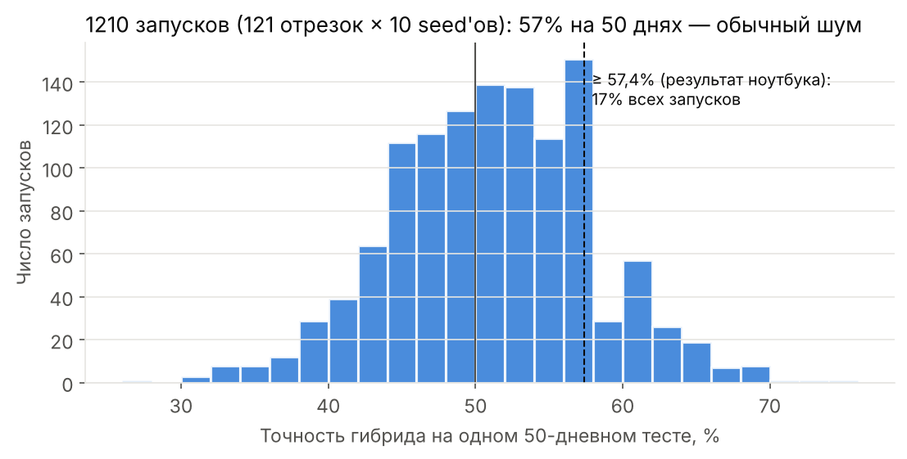
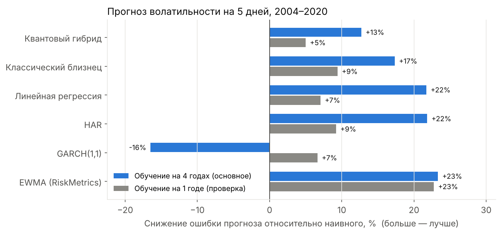
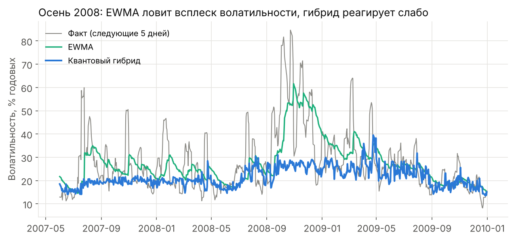

# Гибридные квантово-классические нейросети в прогнозе финансовых рядов

Исследовательский проект (МФТИ, ЛФИ, менторская программа). Вопрос: даёт ли квантовый слой в нейросети преимущество в прогнозе по сравнению с классической моделью той же архитектуры? Проверка на двух задачах, на дневных данных акций **AmerisourceBergen** (NYSE: ABC; фармацевтический дистрибьютор, с 2023 года — Cencora) за 1995–2020 годы:

1. **Направление цены на завтра.** Устойчивого сигнала нет ни у одной модели, включая классические. Первоначальные 57% точности на одном отрезке оказались шумом малой выборки.
2. **Волатильность на 5 дней вперёд.** Сигнал есть: лучшие модели снижают ошибку на 22–23% относительно наивного прогноза. Квантовый гибрид (−13%) стабильно уступает своему классическому близнецу (−17%): во всех 10 seed'ах, тест Диболда–Мариано p < 10⁻⁷. Управление размером позиции по прогнозу волатильности поднимает Sharpe с 0.47 до 0.64.

**Итог: в этих задачах квантовый слой не даёт преимущества.** Самые сильные результаты показывают простые отраслевые модели (EWMA, HAR).

## Модели

Гибрид и классический близнец имеют одинаковую архитектуру и отличаются средним слоем (в части 2 ещё и функцией активации, если её так выбрал подбор настроек):

```
признаки → Linear(6, 4) → clamp[−1, 1] или tanh → [ средний слой ] → Linear(4, 1)

  квантовый гибрид:      × π → 4 кубита: AngleEmbedding (RX) + 2 слоя BasicEntanglerLayers → ⟨Z⟩
  классический близнец:  Linear(4, 4)
```

Выходной слой инициализируется нулями, а входной при одном seed'е у обеих моделей одинаковый, поэтому обе стартуют из одной точки.

Квантовая схема взята из `notebooks/02_regression_hybrid_vs_classic.ipynb` (PennyLane). Для сотен перезапусков она реализована на NumPy (`src/qsim.py`): statevector-симуляция, точные градиенты adjoint-методом. Тесты проверяют, что симулятор совпадает с поэлементным расчётом схемы, а градиенты — с parameter-shift rule и конечными разностями (`tests/test_qsim.py`). Отдельный тест сверяет симулятор с самим PennyLane (`tests/test_qsim_vs_pennylane.py`).

---

## Часть 1. Направление цены

**Постановка** (как в исходном ноутбуке): признаки — изменение цены открытия и объёма за 3 дня, цель — лог-доходность завтра, сигнал long/short по её знаку. Обучение на 200 днях, тест на следующих 50. Эта постановка повторена **121 раз со сдвигом** по всей истории (1996–2020, 5 949 дней), с 10 seed'ами, комиссией 5 б.п. и бейзлайнами.

| Модель | Точность направления | Sharpe до комиссий | Sharpe после комиссий | Доходность в год после комиссий |
|---|---|---|---|---|
| Buy & hold (всегда long) | 51.9% | 0.39 | 0.39 | +13.8% |
| Моментум («завтра как сегодня») | 49.5% | 0.18 | −0.20 | −6.5% |
| Логистическая регрессия | 50.6% | 0.21 | −0.09 | −3.0% |
| Классический близнец, 10 seed'ов | 50.6 ± 0.3% | 0.28 ± 0.11 | −0.07 ± 0.11 | −2.2% |
| Квантовый гибрид, 10 seed'ов | 50.6 ± 0.5% | 0.05 ± 0.20 | −0.30 ± 0.20 | −9.3% |

- Все модели находятся в пределах случайного угадывания и уступают buy & hold. В признаках нет информации о завтрашнем направлении.
- На одном 50-дневном тесте точность гибрида колеблется от ~30% до ~70%, а 57% и выше получается в 17% запусков. Отсюда и исходные «57% и +28%».



Подробности и остальные графики лежат в `results/direction/`.

---

## Часть 2. Волатильность

Направление цены почти непредсказуемо, а её размах предсказуем: за спокойными днями обычно следуют спокойные, за бурными бурные. Прогноз волатильности — рабочая задача риск-менеджмента, опционов и управления размером позиции.

**Постановка**
- **Цель:** логарифм средней дневной дисперсии на следующие 5 дней по оценке Паркинсона (по диапазону High–Low).
- **Признаки (6):** дисперсия за последний день, неделю и месяц (структура HAR), средний квадрат доходности за неделю, сегодняшняя доходность (эффект левереджа), объём относительно среднего за месяц.
- **Walk-forward:** модель учится на последних 4 годах и прогнозирует следующий год, затем окно сдвигается на год. Последние 5 дней обучения выбрасываются (embargo), потому что их 5-дневные цели заходят в тестовый период. Для проверки устойчивости тот же расчёт сделан с окном обучения 1 год.
- **Подбор настроек** (функция активации, скорость обучения, число эпох) делается отдельно для каждой сети и только на первых 5 годах теста (`src/tune_volatility.py`). Итоговые цифры — на общем для обоих окон периоде **апрель 2004 – март 2020** (~4 000 дней), который в подборе не участвовал.
- **Бейзлайны:** наивный («как прошлая неделя»), EWMA (RiskMetrics, λ = 0.94), GARCH(1,1), регрессия HAR (Corsi, 2009), линейная регрессия на тех же 6 признаках.
- **Метрики:** MSE логарифма прогноза и снижение ошибки относительно наивного прогноза, QLIKE, тест Диболда–Мариано с поправкой Ньюи–Уэста.

### Результаты



| Модель | Снижение ошибки, окно 4 года (основное) | Окно 1 год (проверка) |
|---|---|---|
| EWMA (RiskMetrics) | **23%** | **23%** |
| HAR | 22% | 9% |
| Линейная регрессия | 22% | 7% |
| Классический близнец (ансамбль 10 seed'ов) | 17% | 9% |
| Квантовый гибрид (ансамбль 10 seed'ов) | 13% | 5% |
| GARCH(1,1) | −16% | 7% |

Отдельные запуски без усреднения по seed'ам: гибрид 9.0 ± 1.3% при окне 4 года и −0.7 ± 2.5% при окне 1 год; классика 16.5 ± 1.1% и 9.1 ± 0.6%.

**Выводы**

1. **Квантовый слой проигрывает классическому.** Гибрид хуже близнеца во всех 10 seed'ах при обоих окнах (DM-тест: p < 10⁻⁷ для 4 лет, p = 0.013 для 1 года) и сильнее зависит от seed'а. Вероятная причина: выход квантового слоя ⟨Z⟩ ограничен отрезком [−1, 1], и модель плохо передаёт резкие всплески волатильности. Это видно на кризисе 2008 года (график ниже).
2. **Одного года обучения мало.** Модели, которым нужно обучение (HAR, линейная, нейросети), при окне в 1 год ошибаются заметно сильнее: у HAR снижение ошибки 9% против 22%. EWMA не обучается и плавно забывает старые данные, поэтому лучше всех при коротком окне. Адаптироваться к меняющемуся рынку лучше через саму модель, чем через короткое окно данных.
3. **Простые модели — сильные соперники.** EWMA и HAR не уступают нейросетям и лучше квантового гибрида. С этими бейзлайнами и стоит сравнивать любую новую модель.
4. **GARCH с окном 4 года сильно проигрывает.** Он моделирует доходности close-to-close (с ночными гэпами), а не дневной диапазон, и медленно возвращается к средней за 4 года. Это скорее ограничение постановки, чем самой модели.



### Применение: управление размером позиции

Позиция в акции масштабируется так, чтобы ожидаемая волатильность равнялась волатильности обучающего периода (плечо не выше 2, комиссия 5 б.п. за оборот). Период — 2004–2020, окно обучения 4 года:

| Стратегия | Sharpe | Доходность в год | Волатильность в год | Макс. просадка | Среднее плечо |
|---|---|---|---|---|---|
| Buy & hold | 0.47 | 12.2% | 24.7% | 51% | 1.00 |
| По прогнозу EWMA | **0.64** | 19.5% | 27.9% | 49% | 1.21 |
| По прогнозу HAR | 0.56 | 15.8% | 26.1% | 46% | 1.13 |
| По прогнозу классического близнеца | 0.56 | 15.4% | 25.8% | 48% | 1.12 |
| По прогнозу квантового гибрида | 0.54 | 15.0% | 25.8% | 49% | 1.11 |

Прогноз волатильности повышает доходность на единицу риска (Sharpe) и не увеличивает просадку. Часть прироста доходности объясняется средним плечом выше 1, поэтому сравнивать стратегии корректно именно по Sharpe. Лучший результат снова у EWMA. Данные для окна 1 год лежат в `results/volatility/1y/vol_targeting.csv`.

## Что можно улучшить

- Сравнить гибрид с более выразительной квантовой схемой (другое кодирование, data re-uploading) и проверить, сохраняется ли отставание.
- Проверить на нескольких активах и на свежих данных (котировки в репозитории заканчиваются в марте 2020).
- Использовать внутридневные данные для точной реализованной волатильности.

## Структура репозитория

```
├── data/ABC.csv                 дневные котировки AmerisourceBergen 1995–2020 (и укороченные выборки)
├── notebooks/                   исходные исследования
│   └── 02_regression_hybrid_vs_classic.ipynb   ← основная постановка с ментором
├── src/
│   ├── qsim.py                  симулятор квантовой схемы (NumPy, adjoint + parameter-shift)
│   ├── models.py                гибрид, классический близнец, Adam
│   ├── data.py, run_direction.py, make_direction_figures.py         часть 1
│   ├── vol_data.py, vol_baselines.py, tune_volatility.py,
│   │   run_volatility.py, make_volatility_figures.py                часть 2
│   └── backtest.py              метрики и бэктест
├── tests/                       проверки симулятора и градиентов
├── results/direction/           часть 1: метрики, предсказания, графики
├── results/volatility/          часть 2: 1y/ и 4y/ — настройки, метрики, DM-тесты, предсказания
└── learning/                    учебный туториал PennyLane (TorchLayer)
```

## Как воспроизвести

```bash
pip install -r requirements.txt
python -m pytest tests                                  # проверки симулятора, сверка с PennyLane

python src/run_direction.py --seeds 10 --workers 2      # часть 1, ~30 минут
python src/make_direction_figures.py

python src/tune_volatility.py --train 1000              # часть 2, окно 4 года (~1 час)
python src/run_volatility.py --train 1000 --seeds 10
python src/tune_volatility.py --train 250               # проверка: окно 1 год (~10 минут)
python src/run_volatility.py --train 250 --seeds 10
python src/make_volatility_figures.py
```

Ноутбуки из `notebooks/` запускаются из этой папки: пути к данным указаны как `../data/...`.

## Литература

- Corsi F. *A Simple Approximate Long-Memory Model of Realized Volatility*. Journal of Financial Econometrics, 2009.
- Parkinson M. *The Extreme Value Method for Estimating the Variance of the Rate of Return*. Journal of Business, 1980.
- Diebold F., Mariano R. *Comparing Predictive Accuracy*. Journal of Business & Economic Statistics, 1995.
- Kim J. et al. *A Comprehensive Survey of Deep Learning for Time Series Forecasting*, 2025. [arXiv:2411.05793](https://arxiv.org/abs/2411.05793)
- PennyLane: [Turning quantum nodes into Torch Layers](https://pennylane.ai/qml/demos/tutorial_qnn_module_torch)
